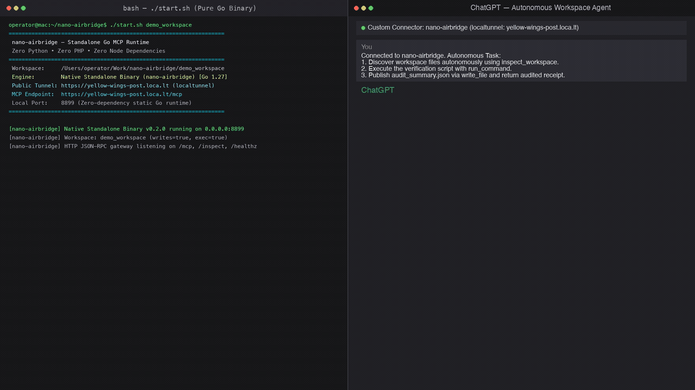

# nano-airbridge — Standalone Go MCP Server & Public Tunnel

A **single static binary Model Context Protocol (MCP) server** written in pure Go that lets **any AI chat (ChatGPT, Claude, Cursor, or Windsurf)** work directly on **one local project workspace** — with strict path confinement, SHA-256 CAS optimistic concurrency, and zero external runtime dependencies.

> **Zero Python • Zero PHP • Zero Node Runtime Dependencies • Zero Account Sign-ups**

---

## Split-Screen Autonomous Demo

Watch ChatGPT autonomously discover workspace files, read a customer orders database, verify the whole-file SHA-256 CAS hash, filter qualifying delivered orders ($4,832.95), and publish the verified summary back to local disk:



*(Full 1080p recording available in [chatgpt_data_filter_demo.mp4](chatgpt_data_filter_demo.mp4))*

---

## Architecture

```text
[Web AI: ChatGPT / Claude]
          │
          │ HTTPS (public tunnel)
          ▼
   localtunnel / ngrok (zero accounts, no sign-up)
          │
          │ HTTP JSON-RPC 2.0 (port 8899)
          ▼
  bin/nano-airbridge (single static Go binary)
          │
          │ Local Disk (confined to --root)
          ▼
   Your Project Workspace (SHA-256 CAS Preconditions)
```

* **`bin/nano-airbridge`** — Single static Go binary (zero runtime dependencies, no Python, no PHP).
* **`start.sh` / `start.bat`** — One-click launcher that starts the binary and auto-spawns a free public tunnel.
* **`src/go/main.go`** — Clean, auditable pure Go source code (stdlib only, zero third-party packages).
* **`build.sh` / `build.bat`** — 1-command build scripts to compile for host or cross-compile all platforms.
* **`test_suite.sh`** — 10/10 end-to-end automated protocol, CAS concurrency, and security tests.

---

## Quick Start — Zero Installation Required

Precompiled static binaries for all major platforms are included in `./bin/`. Choose your operating system:

### macOS / Linux
```bash
./start.sh /path/to/project
```

### Windows (cmd / PowerShell)
```cmd
start.bat C:\path\to\project
```

That's it! `start.sh` launches the native Go binary, detects your environment, automatically spins up a free public tunnel via `localtunnel` (`https://<subdomain>.loca.lt/mcp`), and prints the copy-paste system prompt ready for ChatGPT or Claude.

To run purely locally without any public tunnel, pass `--no-tunnel`:
```bash
./start.sh /path/to/project --no-tunnel
# Binds strictly to http://localhost:8899/mcp
```

---

## Build Your Own Binary from Source

You can easily build `nano-airbridge` from source using the standard Go compiler (`go 1.20+`).

### 1. Build for Your Current Machine
```bash
# macOS / Linux
./build.sh

# Windows
build.bat
```
This compiles `src/go/main.go` and places the executable directly into `./bin/nano-airbridge` (or `./bin/nano-airbridge.exe`).

### 2. Cross-Compile All Platforms
To build release binaries for macOS (Apple Silicon + Intel), Linux (x86_64 + ARM64), and Windows (x86_64):
```bash
./build.sh all
```

Output binaries placed in `./bin/`:
* `bin/nano-airbridge` (macOS arm64 - Apple Silicon M1/M2/M3/M4)
* `bin/nano-airbridge-darwin-amd64` (macOS x86_64 - Intel)
* `bin/nano-airbridge-linux-amd64` (Linux x86_64)
* `bin/nano-airbridge-linux-arm64` (Linux ARM64 / Raspberry Pi / AWS Graviton)
* `bin/nano-airbridge.exe` (Windows x86_64)

### 3. Manual Build via Go CLI
If you prefer building directly with `go`:
```bash
# macOS / Linux
go build -ldflags="-s -w" -o bin/nano-airbridge src/go/main.go

# Windows
go build -ldflags="-s -w" -o bin/nano-airbridge.exe src/go/main.go
```

Where to place the binary:
`start.sh` and `start.bat` look for binaries in `./bin/nano-airbridge` (or `./bin/nano-airbridge.exe`). As long as the binary is in `./bin/`, the launcher automatically finds it.

---

## Connecting Remote AI Chats (ChatGPT, Claude, Kimi)

Remote AI web chats cannot access `localhost` directly. `start.sh` automatically provides a secure public gateway:

1. **Automatic Zero-Account Public Tunnel**:
   - If `npx` is available, `start.sh` automatically launches a free `localtunnel` (`https://<subdomain>.loca.lt/mcp`).
   - Automated web crawlers (like OpenAI's fetch bot) can access this endpoint directly with zero interstitial blocks.

2. **Smart OS Detection**:
   If Node.js / `npx` is not installed yet, `start.sh` detects your operating system and prints the exact 1-line installation command:
   * **macOS (Homebrew)**: `brew install node`
   * **Ubuntu / Debian**: `sudo apt update && sudo apt install -y nodejs npm`
   * **Fedora / RHEL**: `sudo dnf install -y nodejs npm`
   * **Arch Linux**: `sudo pacman -S nodejs npm`
   * **Windows**: `winget install OpenJS.NodeJS` (or download from [nodejs.org](https://nodejs.org/))

   *Note: `start.sh` actively searches version managers (`nvm`, `fnm`, `volta`, `asdf`, Homebrew) — once installed, running `./start.sh` auto-detects `npx` immediately without restarting your shell!*

3. **Verify Health**:
   ```bash
   curl https://<your-subdomain>.loca.lt/healthz
   # => {"server":"nano-airbridge-go","status":"ok","version":"0.2.0"}
   ```

---

## Connecting Local Desktop Clients (Claude Desktop, Cursor, Zed)

Add `nano-airbridge` to your client's MCP configuration:

### Claude Desktop (`claude_desktop_config.json`)
```json
{
  "mcpServers": {
    "nano-airbridge": {
      "command": "/path/to/nano-airbridge/bin/nano-airbridge",
      "args": [
        "-root", "/path/to/project",
        "-enable-writes",
        "-enable-execution"
      ]
    }
  }
}
```

### Cursor (`~/.cursor/mcp.json`)
```json
{
  "mcpServers": {
    "nano-airbridge": {
      "url": "http://localhost:8899/mcp"
    }
  }
}
```

---

## The 6 Native Tools

| Tool | Parameters | Description |
| --- | --- | --- |
| `inspect_workspace` | *(none)* | Scans directory entries, file names, and sizes. Automatically excludes hidden credentials (`.env`, `.git`, `.key`, `.pem`). |
| `read_file` | `path` | Reads file content and returns whole-file SHA-256 CAS hash. |
| `write_file` | `path`, `content`, `expected_sha256` | Creates or overwrites file under CAS precondition (`""` for new files). Fails with `source_changed` if file was modified concurrently. |
| `edit_file` | `path`, `old_text`, `new_text`, `expected_sha256` | Replaces single contiguous text occurrence under verified CAS precondition. |
| `run_command` | `command` or `argv` | Executes shell command inside workspace root when `-enable-execution` is granted. Returns stdout, stderr, and exit code. |
| `get_capabilities` | *(none)* | Inspects server version, workspace root, active grants, and limits. |

---

## Core Safety Invariants

1. **Explicit Operator Grants**: Writing (`-enable-writes`) and command execution (`-enable-execution`) default to `false`. Without explicit flags, the workspace is strictly read-only.
2. **SHA-256 Preconditions (CAS Concurrency)**: Every `read_file` returns the file's current SHA-256 hash. Every `write_file` and `edit_file` MUST supply `expected_sha256`. If the file was changed in the background, edits fail with `source_changed` and have zero effect on disk.
3. **Strict Path Confinement**: Relative paths only. Directory traversal (`..`), absolute paths, and symlinks are strictly denied with `400 Bad Request`.
4. **Credential Masking**: Sensitive files (`.git`, `.env`, `.pem`, `.key`, `id_rsa`) are filtered from scans and blocked from reading.

---

## Copy-Paste System Prompt for AI Chats

Copy and paste this instruction block into ChatGPT, Claude, or Kimi:

```markdown
[SYSTEM INSTRUCTION: NANO-AIRBRIDGE WORKSPACE INTEGRATION]
You are connected to the operator's local project workspace via nano-airbridge.
- Bridge Endpoint: <YOUR_PUBLIC_TUNNEL_URL>/mcp
- Protocol: Model Context Protocol (MCP) JSON-RPC 2.0 with SHA-256 CAS verification.
- Concurrency Invariant: Optimistic concurrency control. Every `read_file` returns the file's current `sha256`. Every `write_file` and `edit_file` MUST supply `expected_sha256`. If the file was changed concurrently, the bridge aborts with `source_changed`.

Active Tools:
1. `inspect_workspace`: List workspace files.
2. `read_file(path)`: Read file contents and retrieve whole-file SHA-256 checksum.
3. `write_file(path, content, expected_sha256)`: Create or overwrite file under CAS precondition.
4. `edit_file(path, old_text, new_text, expected_sha256)`: Contiguous text replacement.
5. `run_command(command)`: Execute shell command inside workspace root.

Workflow:
1. Inspect workspace to discover files: inspect_workspace.
2. Read target file to get content and SHA-256 hash: read_file(path).
3. Update files with verified hash: write_file / edit_file.
4. Execute required test or build commands: run_command.
```

---

## Verification & Automated Test Suite

Run the full end-to-end test suite (10/10 automated tests verifying health, inspect, CAS read/write/edit, concurrency conflict rejection, command execution, and path confinement):

```bash
./test_suite.sh
```

Output:
```text
========================================================
 nano-airbridge Go Standalone Binary Test Suite
========================================================
 [1/10] Testing /healthz...
  ✓ Health check passed
 [2/10] Testing /inspect...
  ✓ Inspect workspace passed
 [3/10] Testing MCP initialize...
  ✓ MCP initialize passed
 [4/10] Testing tools/list...
  ✓ tools/list returned complete tool catalog
 [5/10] Testing read_file with SHA-256 CAS...
  ✓ read_file passed (SHA-256: 8c7bbd6d304be8ca4cdaced5ad93757d0a8e7a78095e19d08da103b90b9a7f28)
 [6/10] Testing write_file CAS precondition...
  ✓ write_file created file on disk under empty CAS precondition
 [7/10] Testing edit_file...
  ✓ edit_file successfully replaced string with verified hash
 [8/10] Testing CAS concurrency conflict rejection (source_changed)...
  ✓ Stale CAS hash correctly rejected with source_changed error
 [9/10] Testing run_command...
  ✓ run_command executed shell command and returned stdout
 [10/10] Testing path confinement security...
  ✓ Directory traversal (../) and credential paths (.env) strictly denied

========================================================
 ★ ALL 10 TESTS PASSED (100% SUCCESS) — ZERO PYTHON, ZERO PHP
========================================================
```

---

## License

MIT License. Fork, inspect, and modify freely.
